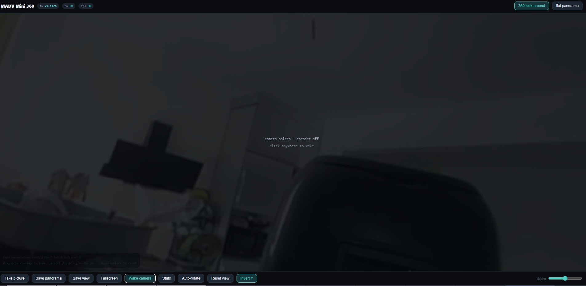
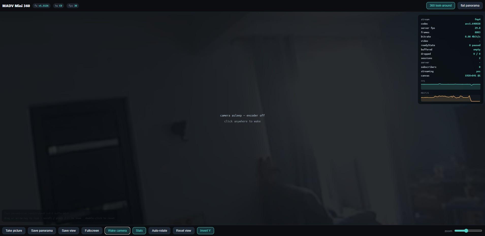

# free60

Keeping a forgotten 360° camera alive, and giving it back to the world.

The **MADV Mini** (`com.madv.mini`) was a tiny USB-C panoramic camera from 2018.
It only ever worked through one Android app. The app is gone from Play, the
cloud endpoint (`api.madv360.com:9999`) is dead, and the hardware has been
abandoned. This project makes the camera work again — on Linux, with no app,
no cloud, and no Android.

> `free60` = **free** the **360** camera.



*Streaming: the camera's own H.264, 1920x960 at ~30 fps and 5.5 Mbit/s, nothing
dropped. The panel shows the real numbers — codec, bitrate from bytes actually
written, buffered range, dropped frames.*



*Idle: the encoder is off, the bitrate reads 0.00, there are no subscribers, and
the sparklines fall to nothing. This is what keeps the camera cool between
viewers — it is still on the USB bus and wakes on the next request.*

---

## What the device actually is

Marketing called it a 360 camera with "an app". The useful truth, recovered by
reverse-engineering the last surviving APK:

| | |
|---|---|
| SoC | Sunplus / iCatch **SPCA6350** family, RTOS (no Linux inside) |
| Host link | **USB-C tether only** — no Wi-Fi, no Bluetooth |
| USB class | Vendor-specific `ff/06/50` — Mass Storage **Bulk-Only Transport** |
| Command set | Vendor **SCSI** opcodes `0x7A` (act/read) and `0x7B` (write) |
| Live view | **H.264 High, 1920×960, ~30 fps** |
| Projection | **already-stitched equirectangular panorama (2:1)** |
| Firmware on unit | `v1.1126` — the exact image was shipped inside the APK |

The "heavy Android dependency" was never exotic. The camera is a USB SCSI
gadget; Android merely happened to be the only thing hosting it.

**Key discovery:** the camera accepts `start live view` and then answers "busy"
forever until it has been sent the full settings block (`7B 04 60`,
`WRITE_SET_ALL_SETTING`, bitrate 8). The app always sends it first. That single
message was the difference between a dead camera and a video stream.

Full protocol documentation: **[STATE.md](STATE.md)** — transport framing,
every opcode, reply layouts, and the mistakes made along the way.

---

## Status

Working, verified against real hardware:

- ✅ enumeration, session open/close, keep-alive, auto-recovery
- ✅ all settings read/write, date/time
- ✅ **live view — H.264 1920×960 @ ~30 fps**, decodes cleanly
- ✅ thumbnail download (272×272 JPEG)
- ⚠️ still capture **trigger** — the camera accepts it, but this cannot give
  you a usable photo yet. See the open item below
- ✅ browser demo with a drag-to-look 360° viewer
- ✅ **idle handling** — with no viewer the encoder is stopped (cool) and the
  next request brings the stream straight back; the device stays on the bus
- ✅ **low-CPU streaming.** The camera's own H.264 is handed to the browser
  untouched — WebCodecs when the page is a secure context, MediaSource
  otherwise. No re-encode in either path, and ffmpeg only runs while an MSE
  viewer is actually connected.
- ✅ **http and https on the same port**, so the decoder is a URL choice:
  `https://` gets WebCodecs (lower latency), `http://` gets MediaSource (more
  tolerant of jitter).
- ✅ **a virtual webcam** — the panorama projected to a flat view and published
  through v4l2loopback, so Zoom and friends see a normal camera.

Open:

- ⬜ **photographs, end to end.** This is the big one, and it is worth being
  blunt: pressing capture stores an image **inside the camera**, and the
  command that reads it back (`7A 05 02`) has never returned a single byte. The
  only image ever recovered from a capture is a **272x272 thumbnail**. So there
  is no "save location" to report — there is no working download.

  On the test unit capture also **resets the USB connection**: dmesg shows a
  disconnect and re-enumeration at the moment of capture, three times in one
  session, with no over-current report. The service recovers on its own in a
  few seconds (or `tools/recover.sh` forces it). A current spike on a marginal
  port is the leading suspicion — capture worked on a direct port and stopped
  working behind an extension — but that is unproven.
- ⬜ video recording (`7A 01 03`) — command accepted, untested end-to-end
- ⬜ firmware reflash path — I hold the exact image and the recovered
  protocol, but the `.prm` patch step is not reimplemented and nothing has
  been flashed. See [docs/FIRMWARE-RECOVERY.md](docs/FIRMWARE-RECOVERY.md)

---

## Requirements

Any Linux box with a **free USB host port**. That is the only hard constraint —
the camera is tether-only (no Wi-Fi, no Bluetooth, no battery), so it has to be
physically plugged into the machine running this.

| Need | Why | Notes |
|---|---|---|
| Python 3.8+ | the driver | distro `python3-usb` is enough; no venv required |
| `libusb-1.0` | USB access | vendor-class device, no kernel driver binds it |
| udev rule | unprivileged access | `tools/60-madv-mini.rules` |
| `ffmpeg` | the MJPEG and mp4/MSE paths | **not needed for WebCodecs** (auto + https). Not installed by default; `--with-ffmpeg` to add it |

No compiler, no kernel module, no GPU, no bootloader work. x86_64, arm64 and
armv7 all work — the driver is pure Python over libusb.

Why Python rather than Rust: **[docs/DESIGN.md](docs/DESIGN.md)** — including
the measurements that say where Python is the wrong answer.

The story of the recovery, and the three things I got confidently wrong along
the way: **[docs/STORY.md](docs/STORY.md)**.

## Portability

| Platform | Status | Notes |
|---|---|---|
| Linux | **proven** | x86_64 (Debian/Ubuntu) and AArch64 (Armbian on S905X / S912 / H616 TV boxes) |
| macOS | expected, **untested** | needs `libusb` and pyusb. No driver binding should be needed — the camera is vendor-class, so macOS has nothing that would claim it |
| Windows | expected, **untested** | needs `libusb` plus a **WinUSB/libusbK driver bound to the camera** (Zadig). Windows has no driver for a class `0xff` device, so otherwise it sits there as an unknown device |

The driver itself is portable by construction: pure Python over pyusb, building
the USB Mass-Storage CBW/CSW envelope itself, with no kernel driver to satisfy.

**Linux-only pieces**, and nothing else:

- `tools/setup-host.sh` — apt and udev
- `tools/60-madv-mini.rules` — udev
- the `SG_IO` fallback transport — the default libusb transport is what
  everything actually uses

Trying it on Windows or macOS: install pyusb and libusb, run
`python tools/madv.py probe`, then the web demo. The first thing I would expect
to break is `os.read(ff.stdout.fileno())` in the capture loop — pipe semantics
differ on Windows — and `--mode mjpeg` would be the mode to start with.
Untested means untested, not "should be fine".

## Power and heat (read before trusting a port)

The camera's USB descriptors claim **Self Powered** and `bMaxPower = 100 mA`.
Do not believe them. There is **no battery**, and while live view is open the
ISP and the H.264 encoder run flat out.

**Actual current draw has not been measured** — that needs inline measurement
hardware this project does not have — but it is plainly well above 100 mA in
use, and the unit gets noticeably warm within minutes of streaming.

**A short USB extension lead is fine and often necessary.** The camera has to
stand upright to give a level panorama, and nobody has an upward-facing USB
port — so in practice it runs on a short passive extension. This project's unit
has been driven that way at a steady 30 fps without trouble. The risk is not
"an extension" as such, it is **weak or overloaded ports**: a busy unpowered
hub, a very long or thin cable, or a port already near its budget.

Failure is misleading. Under-volted, the camera still enumerates and still
acknowledges commands, but never produces a frame — or wedges part-way through
one. A brownout looks exactly like a firmware bug.
- If `probe` and `info` work but `live` stays silent, suspect power before you
  suspect code.
- It has no battery and no soft power switch, so **unplugging is the only hard
  reset** and the only way to fully discharge it.

## Quick start

```bash
git clone <this repo> free60 && cd free60

./tools/setup-host.sh --dry-run   # see what it would change
./tools/setup-host.sh             # libusb, pyusb, udev rule, then probe

<pybin> tools/madv.py info                # expect fw_version = v1.1126
<pybin> tools/madv.py live -n 5 -o live.h264
ffplay live.h264
```

`<pybin>` is whatever the setup script prints at the end: either `python3` or
`./.venv/bin/python`, depending on whether your distro ships pyusb.

- Full deployment checklist, services and firewall traps:
  **[docs/DEPLOY.md](docs/DEPLOY.md)**
- Agent-facing constraints and danger list: **[AGENTS.md](AGENTS.md)**

### Web demo

```bash
./.venv/bin/python tools/madv-web.py --port 8901 --bind <lan-ip> --mode auto --https
```

That is the setup I would use. Press `s` in the page for the full stats panel.

| Mode | What the server does | Good for |
|---|---|---|
| **`auto`** | relays raw H.264; starts ffmpeg only if a viewer asks for mp4 | **what I would use** - the page picks per browser. Not the CLI default (that is still `mjpeg`) |
| `mjpeg` | transcodes to JPEG | any browser, no WebCodecs, no certificate |
| `fmp4` | remuxes to fragmented MP4 (`-c:v copy`) | MSE without the auto machinery |
| `webcodecs` | relays raw H.264, nothing else | forcing the lowest-latency path |

**One port, both schemes.** With `--https` the server peeks the first byte on
each connection: a TLS ClientHello gets wrapped, a plain HTTP request is served
as-is. So the *URL* selects the decoder:

| URL | Transport | Decoder | Latency |
|---|---|---|---|
| `https://<host>:8901` | TLS | **WebCodecs** | lowest — each access unit goes straight to the decoder |
| `http://<host>:8901` | plain | **MediaSource** | higher — MSE buffers ahead by design, but rides out jitter |

For `--https` the server generates a self-signed certificate on first run (SANs
for every local address, key at `0600`, in `certs/`, gitignored). The browser
warns once; accept it and `VideoDecoder` exists. No CA, no tailnet, no reverse
proxy — which matters, because a tailnet certificate would only help tailnet
devices. Pass `--cert`/`--key` to use a real one instead.

Drag to look around, scroll/pinch to zoom, double-click to reset. The "flat
panorama" tab shows the raw 2:1 equirectangular frame.

It stops streaming when nobody is watching (`--idle-timeout`, default 60 s) and
wakes on the next request — see the heat note below. The **Sleep camera**
button does it immediately, and its first job is to drop the page's own stream,
because any viewer traffic counts as a reason to wake.

**Stats panel** (`s`): which path and decoder are in use, server fps, frame
count, a real byte-rate measured from bytes the server wrote, resolution,
readyState, buffered range, dropped frames and drop rate, decoder queue depth,
end-to-end latency, whether ffmpeg is available — plus sparklines for fps,
bitrate and latency. It reads exposed state rather than inventing numbers, and
a **copy** button puts the whole thing on the clipboard for bug reports.

**Firewall note:** if the host runs a firewall, open the port before anything
can reach it. On nftables reload **with a delete first** — `nft -f` on an
existing table *appends* and silently duplicates every rule:

```bash
sudo nft delete table inet <table> && sudo nft -f <your-rules-file>.nft
```

Then verify from **another host**. A listener on localhost proves nothing about
the firewall or the LAN path.

### Feeding something other than a browser

The camera's own H.264 is available as a plain fragmented MP4 that any player
can read — ffmpeg, VLC, OBS, a bare `<video src>`:

```
http://<host>:8901/live.mp4
```

To make it an ordinary **webcam**, run this on the machine that wants the
camera (not the one it is plugged into), which needs `v4l2loopback`:

```bash
./tools/virtual-cam.sh --src http://<host>:8901/live.mp4
```

It projects the equirectangular panorama to a flat 95-degree view with ffmpeg's
`v360` filter, so Zoom and friends see a normal camera rather than a warped
panorama. `--raw` leaves it unprojected.

### Tools

| File | Purpose |
|---|---|
| `tools/madv.py` | host driver + CLI (probe/info/live/photo/thumb/shoot/record/sleep/poweroff/raw/dump) |
| `tools/madv-web.py` | HTTP/HTTPS server + 360° browser demo |
| `tools/setup-host.sh` | installs libusb, pyusb, the udev rule, optionally the systemd unit |
| `tools/recover.sh` | software replug: reset, unbind/bind, restart the service |
| `tools/still-probe.py` | one uninterrupted capture → download pass (see the open items) |
| `tools/virtual-cam.sh` | publish the stream as a V4L2 webcam (viewer-side) |
| `tools/axml.py` | standalone Android binary-XML parser (used to read the APK manifest) |
| `tools/60-madv-mini.rules` | udev rule for `464a:4d02` |

`madv.py` deliberately has **no dependencies beyond pyusb** — it builds the
Bulk-Only CBW/CSW envelope by hand, because the camera declares a vendor class
and no kernel driver will bind it.

---

## Reporting a problem

Open an issue. What makes one useful:

- **the numbers.** Open the page, press `s`, press **copy** — that puts the
  whole stats panel on your clipboard including your browser's user agent.
- `<pybin> tools/madv.py info` — the firmware version matters. Everything here
  was measured on **v1.1126**.
- whether it also happens with `--mode fmp4` or `--mode mjpeg`, if you can
  switch. That single data point separates "the camera" from "the transport".

Two things worth checking before you file it:

- **capture resets the camera and the page goes black for a few seconds** —
  that is expected on marginal power. Try a powered hub before assuming a bug.
- **a black page over `http://`** is the secure-context rule, not a fault: use
  `--https`, or `--mode fmp4`.

The open items above are honest about what does not work. If your problem is
one of those, an issue saying "also happens here, fw vX" is still worth filing —
it is how a sample size of one becomes a sample size of many.

---

## Preservation

`firmware/fw11126.zip` is the camera's own firmware, extracted from
`res/raw/` inside the app. It is the insurance policy: if a unit bricks, this is
the image to restore it with. The unit in hand reports `v1.1126`, the exact
match.

`reference/shaders/` holds the app's original GLSL — the spherical projection is
documented there rather than lost.

The original APK is **not** committed (38 MB). Keep a copy; it is the only
surviving description of this device. APKPure hosts it (package com.madv.mini).

If a unit ever bricks, [docs/FIRMWARE-RECOVERY.md](docs/FIRMWARE-RECOVERY.md)
records the recovered flash protocol — read the warnings there first, it is a
last resort and has never been executed.

---

## Notes for the future

- **The camera runs hot.** Streaming keeps the ISP and the H.264 encoder
  running flat out, so a plug-in unit gets noticeably warm within minutes. It
  is not a fault. To cool it, **stop live view** (`7A 01 02`) — that stops the
  encoder and leaves the camera on the bus, ready to resume.
- **Do not `close_session` (`7A 00 02`) to save power.** It powers the camera
  down and it **leaves the USB bus**; getting it back needs a physical replug.
  `madv.py sleep` does this deliberately — use it when putting the unit away,
  not as an idle mode. The web demo only ever stops live view.
- The camera **wedges** after long experiment runs and stops answering. It has
  no battery, so a physical unplug/replug is the only reset.
- `0xFF` in a reply means "asleep" — re-send open communication. The driver
  does this automatically.
- **A live-view frame is not always one reply.** Above 65504 bytes the camera
  splits it across several, marking the last with flag `[1] == 1`. Treating each
  reply as a whole access unit hands a decoder half a frame — and because H.264
  codes macroblocks in raster order, what goes missing is the **bottom** of the
  picture. That cost a day: it looked like a projection bug at the nadir, and
  only appeared on the WebCodecs path, because the mp4 path simply concatenates
  the byte stream.
- A reply beginning `0x31 0x01 0x02 0x00` in a downloaded JPEG is a vendor tag
  the official app zeroes out before saving.
- Place the camera **upright** if you want the panorama horizon level; on its
  side the whole panorama is rolled 90°. Learned that the hard way because my workstation is upright, so the ports are sideways.

---

## License

[MIT](LICENSE) for the driver, the web demo and these docs — use it, ship it,
fork it.

That license does **not** extend to material recovered from the vendor's app:
the firmware image, the extracted GLSL and the USB filter stay their owner's
copyright and are included only for interoperability and preservation. See
[NOTICE](NOTICE) for the specifics.

The point of this project is that the hardware outlives the app. Take the code,
take the protocol, and go keep a forgotten camera alive.
